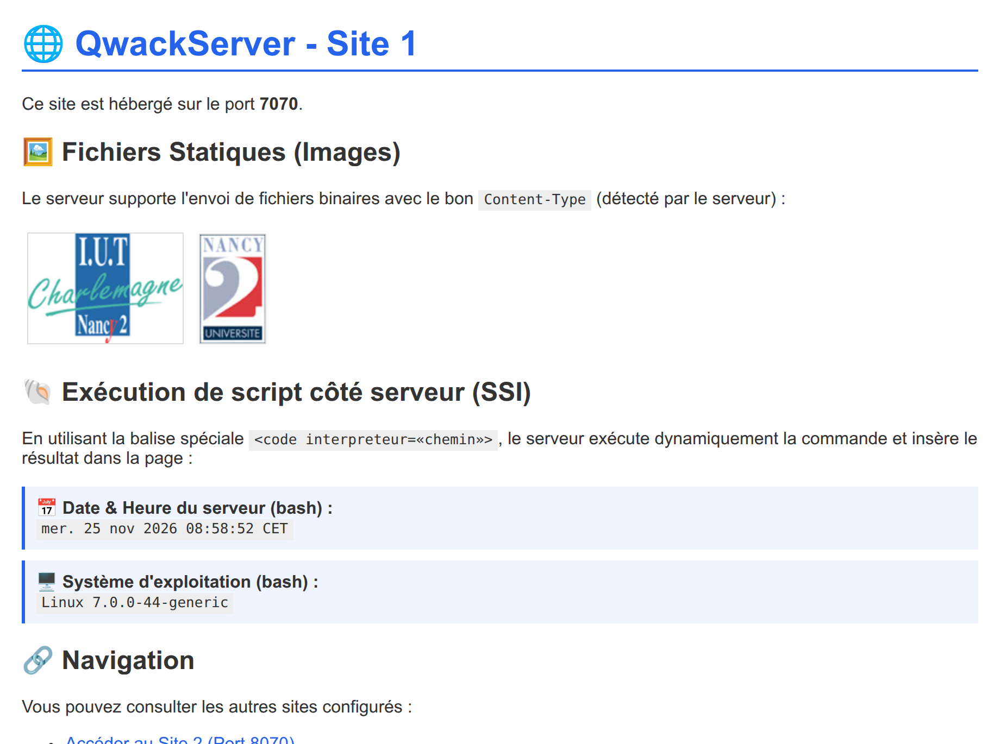
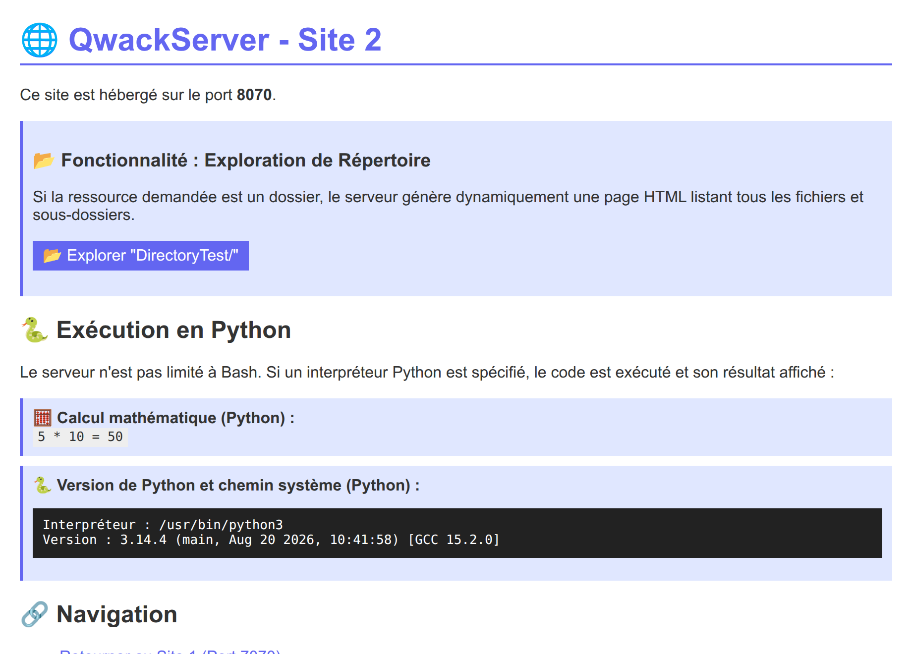
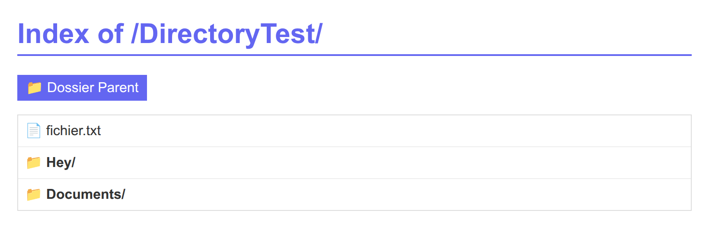
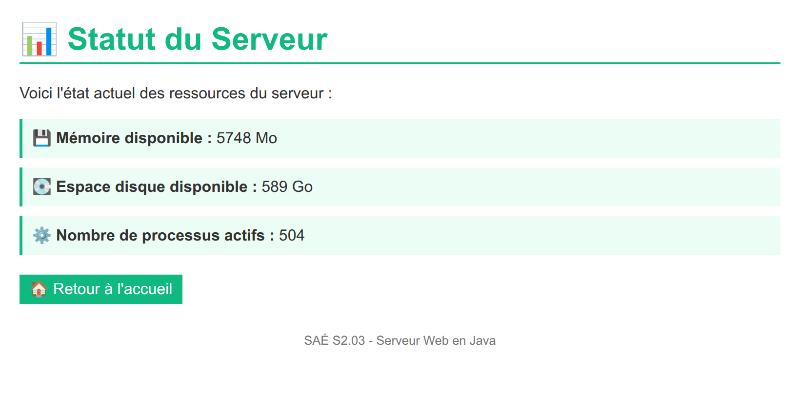

# SAÉ S2.03 — QwackServer : Serveur Web Configurable en Java

Serveur web HTTP/1.1 multi-sites et multi-ports développé de zéro en **Java** (`ServerSocket`, threads) dans le cadre de la **SAÉ S2.03** (BUT Informatique S2 — IUT Nancy-Charlemagne), packagé en **paquet Debian `.deb`** et géré comme service **Systemd**.

---

## Fonctionnalités

- **Multi-sites & multi-ports par configuration XML** : chargement automatique de tous les fichiers `*.conf` dans `conf.d/` (`port`, `DocumentRoot`, `DefaultIndex`, `Acceslog`, `Errorlog`), un thread indépendant par site.
- **Protocole HTTP/1.1 complet (GET)** : détection des types MIME (`Files.probeContentType`), codes de statut `200 OK`, `304 Not Modified`, `403 Forbidden` (protection contre le *path traversal* `..`) et `404`.
- **Compression & mise en cache HTTP** : compression **Gzip** à la volée des ressources statiques (CSS, images, fichiers binaires), calcul d'empreinte **ETag (SHA-256)** et gestion des en-têtes `Last-Modified` / `If-Modified-Since` (`304 Not Modified`).
- **Exécution de scripts côté serveur (SSI)** : interprétation dynamique des balises `<code interpreteur=«/bin/bash»>...</code>` ou `<code interpreteur=«/usr/bin/python3»>...</code> dans les pages HTML.
- **Exploration dynamique de répertoires** : génération automatique d'une page HTML stylisée (`Index of /...`) lorsqu'une URL pointe sur un dossier.
- **Monitoring système `/status`** : route dédiée renvoyant en temps réel la mémoire disponible (`/proc/meminfo`), l'espace disque libre et le nombre de processus actifs.
- **Journalisation par site** : séparation des logs d'accès (`access.log`) et d'erreurs (`error.log`) horodatés.
- **Déploiement Linux natif** : paquet Debian `.deb` avec script `postinst`, fichier `PID`, scripts `start.sh` / `stop.sh` et unité `systemd` (`serverWeb.service`).

---

## Aperçus

### Site 1 (Port 7070) — Fichiers statiques & SSI Bash


### Site 2 (Port 8070) — Exécution Python & Exploration de répertoires




### Route `/status` — Monitoring système en direct


---

## Compilation & exécution locale

```bash
cd serveurWeb/usr/share/serveurWeb
mkdir -p out
javac -d out bin/ServerMain.java bin/Site.java
java -cp out ServerMain
```

Les sites de démonstration configurés dans `conf.d/` sont alors accessibles sur :
- `http://localhost:7070/` (Site 1 — images + SSI Bash)
- `http://localhost:8070/` (Site 2 — SSI Python + `/DirectoryTest/`)
- `http://localhost:8080/status` et `http://localhost:8181/status` (Site 3 — statut système)

---

## Packaging Debian (`.deb`)

Pour compiler les sources puis générer le paquet Debian `.deb` :

```bash
javac -d serveurWeb/usr/share/serveurWeb/out serveurWeb/usr/share/serveurWeb/bin/*.java
dpkg-deb --build serveurWeb
```

Cela produit le fichier `serveurWeb.deb` dans le répertoire courant.

### Installation & désinstallation

```bash
# Installation (configure les droits, enregistre et démarre le service Systemd)
sudo dpkg -i serveurWeb.deb

# Désinstallation (en conservant la configuration)
sudo dpkg -r serveurweb

# Suppression complète (purge)
sudo dpkg -P serveurweb
```

---

## Gestion du service (Systemd)

Une fois installé, le serveur s'exécute en tant que service d'arrière-plan sous le nom `serverWeb.service` :

```bash
sudo systemctl start serverWeb.service
sudo systemctl stop serverWeb.service
sudo systemctl status serverWeb.service
journalctl -u serverWeb.service -f
```

---

## Structure du projet

- **`Diagramme de classe.puml`** : diagramme de classes PlantUML (`ServerMain`, `Site`).
- **`serveurWeb/DEBIAN/`** : métadonnées du paquet Debian (`control`) et script d'installation (`postinst`).
- **`serveurWeb/etc/systemd/system/serverWeb.service`** : unité Systemd.
- **`serveurWeb/usr/share/serveurWeb/`** :
  - `bin/` : sources Java (`ServerMain.java`, `Site.java`).
  - `conf.d/` : fichiers de configuration XML (`serverWeb.conf`, `site3.conf`).
  - `scripts/` : scripts de contrôle (`start.sh`, `stop.sh`).
  - `var/` : sites web hébergés (`site1`, `site2`, `site3`).
